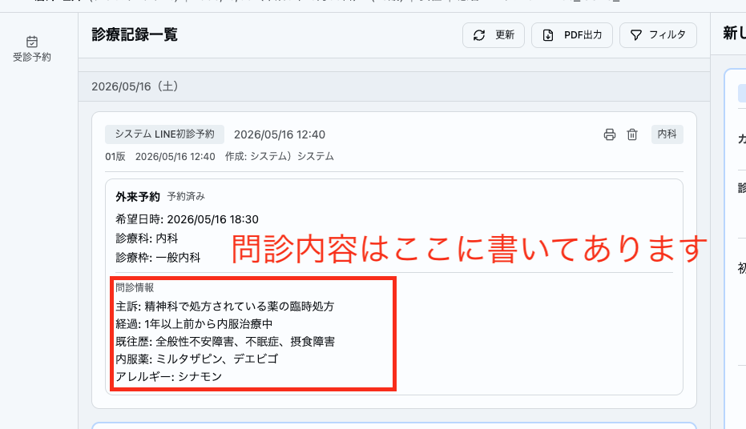
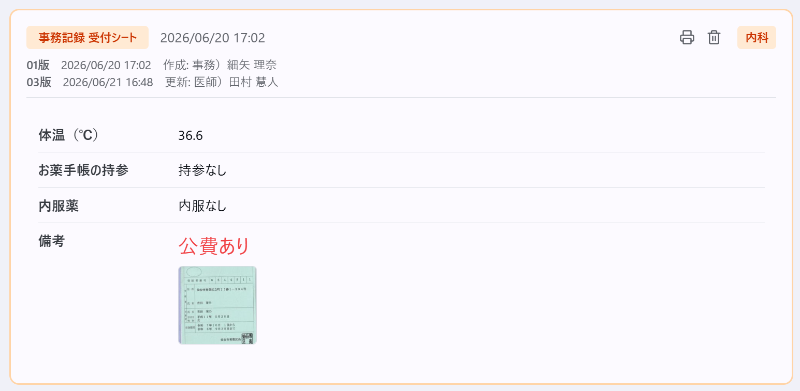

# 受付対応

> **重要**: 受付対応はクリニックを代表するものです。わからないことは憶測で回答せず、必ず確認してから正確な情報をお伝えしてください。

## 対象年齢

当院は内科のため、**診療は原則16歳以上**です。

- **15歳以下の方**には、小児科を標榜する医療機関の受診をご案内する
- **予防接種（インフルエンザ・新型コロナ）は13歳以上なら接種可**。中学生は保護者同伴（予診票に保護者の署名が必要）。12歳以下は接種しない
- **アフターピルも16歳以上**（16歳以上なら未成年でも保護者の同意は不要）。15歳以下の方には産婦人科などへの相談をご案内する

## 来院時の流れ

> 詳しいシステムの操作は[電子カルテ・レセコン操作マニュアル](https://www.notion.so/3356e8ba85c58016818ed588fda40651)で確認してください。

### 予約ありの患者

1. 受付一覧で予約を確認し、受付操作を行う
2. **車で来院したか確認する**
3. **マイナ保険証または資格確認書**を受け取り、資格確認を行う（下記「資格確認（保険証の確認）」を参照）
4. **内服薬の確認**を行う（お薬手帳があればスキャンしてカルテに添付する）
5. **体温測定**を行う
6. 要件に該当する場合は**血圧測定**を行う（下記「血圧測定」を参照）
7. 患者は医師が診察室に案内する

### アフターピル（緊急避妊薬）の患者

> **重要**: アフターピルは**性交後72時間以内**の服用が必要で、早いほど効果が高いです。**最優先で対応**してください。

1. **顔写真付き身分証**を確認する（**16歳以上であること**も確認する）
2. 体温測定・問診・保険確認は不要（診察室で医師が行う）
3. **すぐに診察室に案内する**
4. 看護師に「アフターピルの患者さんです」と伝える（薬と水の準備のため）

### 予約なしで来院された患者

> **重要**: 当院は**予約制**で、予約は**原則LINEから**です（HPでも「ご予約なしでの受診は承っておりません」と案内している）。ただし、直接来院された方を診療拒否することは難しいため（応召義務）、**受付でいちばん近い空き時間に予約を取り、その時間に改めてお越しいただく**。
>
> 例外: **アフターピル**は予約なしでも受診できる（上記「アフターピル（緊急避妊薬）の患者」）。

1. 「当院は予約制のため、いちばん早くご案内できるお時間でご予約をお取りしますね」とお伝えする
2. **受付で直近の空いている時間に予約を取る**
3. 予約時間まで**どこで待っていただくか**をお伝えする
   - **すぐご案内できて、待合も空いている場合** → 院内でお待ちいただいてよい
   - **時間がかなり空く場合** → 待合の椅子が少ないため、**いったん外でお待ちいただき、予約時間に改めてお越しいただく**
4. 次回からは**LINEから予約していただくよう**ご案内する

### 発熱患者

- **発熱外来の時間帯になるまで院内に入れない**（外や車でお待ちいただく）
- ただし、一般内科の時間帯の患者さんが**全員お帰りになった後であれば、早めに院内へ案内してOK**
- 詳しくは「感染対策」の「診療時間帯の区分」を参照

### 診察以外の用件で来院した患者（書類発行のみ・返金対応のみなど）

> **重要**: 診察を伴わない用件だけで来院された場合でも、**対応した内容を必ずカルテに記載してください**。

- 例: 書類（診断書・領収証の再発行など）のお渡しだけ、返金対応だけ、忘れ物の受け取りだけ など
- 「いつ・誰が・何を・いくら（金銭の授受があれば）」対応したかを記載する
- 後から「受け取っていない」「返金されていない」といった行き違いが起きたときに、カルテの記録が証跡になります。**患者さんとのトラブルを避けるため**ですので、お手数ですがよろしくお願いします。

## 問診について

> **患者さんの待ち時間を最小化するために**、状況に応じて問診の取り方を調整してください。

- LINEや電話で既に問診を頂いている場合は、**同じ内容を重複して聞かないこと**
- 必ずカルテを確認してから問診を取る

> 例えば「内服：なし」と回答いただいている患者さんに対して、「内服しているお薬はありませんね？」と確認する聞き方であれば問題ない。ただし、内服薬を詳細に回答したにも関わらず受付で同じ質問をされると、「せっかく問診票書いたのに見てないのかな」と不快に感じられることも少なくない。

### LINE問診の確認方法

カルテの診療記録一覧で、予約情報の下に「問診情報」として表示されている。

### LINEメッセージ送信機能

電子カルテから患者さんのLINEに直接メッセージを送信する機能がある。

- 問診の確認と同様に、**事前にこちら側からどんなメッセージを送っていたか**も確認してから問診を取る
- この機能で送信したメッセージは**取り消し操作ができない**
- 患者さんにメッセージを送信する際は、**必ず院長に確認を取ってから**行う

### 医師が手すきの場合

- 医師が手すきの場合は、問診を詳しく取らなくてよい
- **主訴と内服薬の確認だけ**で大丈夫です
- 詳細な問診は医師が診察時に行います

## 内服薬の確認

お薬手帳がある場合は、以下の範囲をスキャンしてカルテに添付する。

- **直近から見開き4ページ程度**は必ずスキャンする
- 処方日数を確認し、**現在も内服中のページ**は必ずスキャンする
- **直近1ヶ月以内の処方**は必ずスキャンする

> スキャン後はその場で患者さんにお返しせず、**診察前に医師へお渡しください**。医師が手元で確認し、診察時に直接患者さんへお返しします。

## 血圧測定

以下のいずれかに該当する場合は、**必須で血圧測定**を行う。

- **40歳以上**
- **高血圧・糖尿病・高脂血症などの慢性疾患がある**
- **頭痛・めまいの症状がある**
- **ピルを内服していて、かつ咽頭痛がある**

> 受付で血圧を測っていなくても、診察の上で必要があれば改めて診察室で測定するので大丈夫です。

## 資格確認（保険証の確認）

### ふだんの確認方法

| 患者さんがお持ちのもの | 確認のしかた |
| --- | --- |
| **マイナ保険証**（カード） | 顔認証リーダーで確認する |
| **マイナ保険証**（スマホ搭載） | 顔認証リーダーで確認する（実物のカードは不要） |
| **資格確認書**（マイナ保険証をお持ちでない方に保険者が交付） | 目で見て確認し、**必ずスキャンしてカルテに添付する** |
| 従来の健康保険証 | ❌ **使えない**（2025年12月1日で有効期限が終了）。保険者へ資格確認書の交付を確認いただくようご案内する |

資格確認書で確認する項目:

| 確認項目       | 内容             |
| -------------- | ---------------- |
| 有効期限       | 期限切れでないか |
| 氏名・生年月日 | 本人のものか     |
| 負担割合       | 1割・2割・3割    |

### 顔認証リーダーで確認できないとき

停電・カードリーダーの故障・ネットワーク障害・ICチップの破損などで**オンライン資格確認ができない場合**は、以下のいずれかで確認する。

| 患者さんがお持ちのもの | 使えるか |
| --- | --- |
| マイナンバーカード ＋ マイナポータルの資格情報画面（PDF可） | ✅ 可（スマホでその場でログインした画面なら、カードの提示は不要） |
| マイナンバーカード ＋ **紙の**「資格情報のお知らせ」 | ✅ 可 |
| 上記のいずれも無い場合 → **被保険者資格申立書**に記入いただく | ✅ 可 |
| 「資格情報のお知らせ」**のみ**（カードなし） | ❌ 不可 |
| 「資格情報のお知らせ」の**スマホ画面・データ** | ❌ 不可（紙のみ有効） |

### カルテで資格が有効と確認できない場合

電子カルテでは受付時に**資格の有効確認**が行われ、**有効と確認できない場合は受付ステータスを「診察準備完了」に進められない**ようになっている。

1. 患者さんに、**お持ちの保険証（資格）の有効期限が切れている**ことをご説明する
2. 転職・退職・扶養の変更などで**保険が変わっていないか**を伺い、新しい保険の資格確認書・マイナ保険証などがあれば提示していただく
   - 資格そのものが切れている（資格喪失）場合は、マイナポータルの画面などを見せていただいても同じく無効になる
3. ほかに確認できる方法がない場合は、**保険証を忘れた場合と同じ対応**になる

### マイナンバーカードの電子証明書の有効期限

> カード本体の有効期限は10年（未成年は5年）ですが、**中に入っている電子証明書は5年**です。ここが切れるとマイナ保険証として使えなくなります。

- 有効期限の**3ヶ月前〜3ヶ月後**は、顔認証リーダーに**更新アラート**が表示される
- **有効期限が切れてから3ヶ月間は健康保険証として利用可能**。その間にお住まいの市区町村窓口で更新いただくようご案内する
- 3ヶ月を過ぎると資格確認ができないため、資格確認書等での受診が必要になる

> 参照: 厚生労働省「[資格確認方法について](https://www.mhlw.go.jp/stf/newpage_50657.html)」（2026年10月11日確認）

## 公費の確認

公費がある場合は、以下の対応を行う。

1. 公費に関する書類を患者さんからお預かりし、スキャンしてカルテに添付する
2. カルテに**赤文字・大文字で「公費あり」と記載**する
3. お預かりした書類を医師に手渡す

> 公費の登録は医師が診察室側で行い、診察時に直接患者さんへ書類をお返しします。

> 公費は診察前に医師が登録しておく必要があるため、診察を始める前に公費併用であることが医師に伝わっていると助かります。

## クレーム対応

### 基本姿勢

1. まず落ち着いて**傾聴する**（途中で遮らない）
2. 「ご不便をおかけして申し訳ございません」とお詫びする
3. 状況を正確に把握する

### 対応フロー

- **待ち時間への不満** → 現在の混雑状況と目安の待ち時間をお伝えする。改善が難しい場合はお詫びし、院長へ報告する
- **対人トラブル** → 当事者を引き離し、双方の話を別々に聞く。速やかに院長へ報告する
- **判断に迷う場合** → その場で無理に解決しようとせず、院長へ相談する

> クレーム内容は必ずカルテに残し、院長へ報告してください。

## 患者さん向け資料

患者さんからの問い合わせに対応できるよう、以下の資料を受付用に準備している。**デスク引き出し3段目のマニュアルファイル**に入っているので、時間がある時に確認しておくこと。

- **アレルゲン免疫療法**（シダキュア・ミティキュア）
- **アフターピル**（緊急避妊薬）

### アレルゲン免疫療法の動画

患者さん用の動画をGoogle Driveに上げている。**全3本**あるので、勤務中お手隙の際に視聴しておくこと。

- Chromeのお気に入りバーの「**アレルゲン免疫療法**」からフォルダを開ける

## その他

- **受付はなるべく離れない**
- **受付を離れる際には必ず離席札を立てる**
- 医師に確認事項があるときは**極力内線を使用する**（受付を離れる必要がなくなる）
- 院長の年齢を聞いてくる患者さんが時折いらっしゃいます。教えないでください。
- 次回受診時の共有事項やリマインドがある場合は、**患者カルテの掲示板に記載する**
