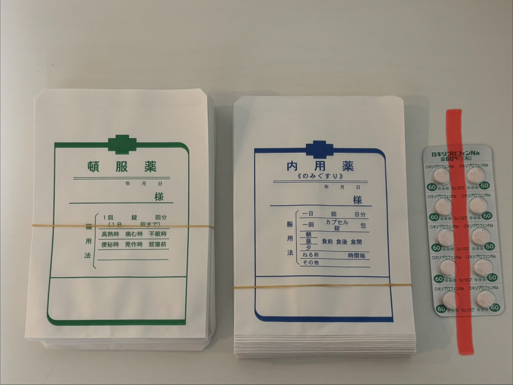

# 院内処方

## 基本の流れ

院内処方は**医師が診察室で行います**。

1. 医師が診察室で薬を準備し、患者さんにお渡しする
2. 診察室側に在庫がない薬剤がある場合は、**看護師がバックヤードから持ってくる**
3. お薬のお渡し後、会計に進んでいただく

> **お薬手帳のお渡しは会計時に受付から行う**（詳細は[会計業務](./03-billing.md)を参照）。

## 違和感があれば報告

看護師・事務スタッフは、医師の処方内容に少しでも違和感（量が多い？いつもと違う？など）を感じた場合、**なるべく早い段階で医師に確認**してください。

## 薬の在庫管理

- **開封済みの処方薬から使う**
- 新たに箱を開封した場合は、**期限チェックシートの期限を更新します**

## 薬袋と調剤

1. 薬袋は**一剤につき一枚**使用し、薬剤名を記入します
2. 薬はワンシート10錠になっており、基本は**半端が出ないよう処方**します
3. 5錠の場合は写真のように**縦にカット**します
