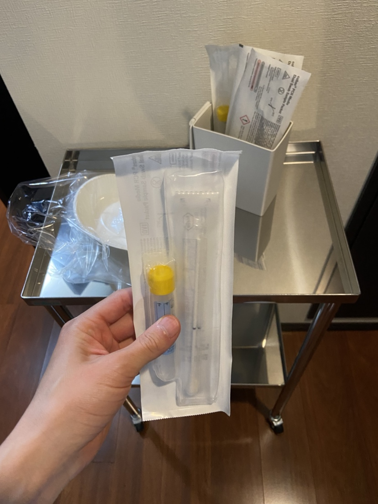

# 検査・処置

## バイタルサイン測定

| 機器               | 用途                   |
| ------------------ | ---------------------- |
| 体温計             | 体温測定               |
| パルスオキシメータ | SpO2（酸素飽和度）測定 |
| 血圧計             | 血圧測定               |

※受付にも一台パルスオキシメータを置きますが、必ずしも診察前に測定する必要がありません。

## 心電図（Nihon Kohden ECG-3250）

- 12誘導心電図の検査機器
- 不整脈や狭心症状の評価に使用します
- 電極の装着位置を正確に確認してから記録を開始します

## エコー（Canon Medical Systems Aplio go / LE）

### 取り扱い注意事項

- エコー（特にプローブ部分）は院内で唯一と言っていい高価な機器なので、取り扱いに要注意です
- 落下・衝撃に十分注意してください
- ケーブルをタイヤ（椅子のキャスター等）で踏まないように注意してください
- コンベックスプローブ（腹部用）とリニアプローブ（甲状腺・頸動脈用）

### プローブの消毒手順

1. ワンウェイガーゼでジェルを拭き取ります
2. 酒精綿で消毒します
3. 綺麗なワンウェイガーゼでアルコールが残らないように拭き取ります

> **注意**
>
> - アルコールが残ると劣化の原因になります
> - 強く清拭すると傷みますので、ワンウェイガーゼで**優しく**拭き取ってください
> - ウェットティッシュやペーパータオルは使用しないでください

### 電源操作

- 電源ONの前にブレーカーを付けます
- 電源OFFの後には必ずブレーカーを切ります

### メンテナンス

- フィルターの掃除を毎週日曜の終業時に行います（埃が溜まると故障の原因になります）

## 迅速抗原検査（院内実施）

以下の迅速検査キットを使用し、短時間で結果を報告します:

| 検査項目                     | 検体       |
| ---------------------------- | ---------- |
| インフルエンザA/B + COVID-19 | 鼻咽頭ぬぐい液 |
| 溶連菌（A群）                | 咽頭拭い液 |

## 採血

### 検体採取の手順

1. 医師から**必要なスピッツを確認**し、準備します
2. ラベルに**患者の氏名と生年月日を手書き**します
3. スピッツにラベルを貼ります
4. 検体を採取します

### 当日回収の場合

- **常温**で保管します

### 翌日回収の場合

1. **生化学スピッツ・凝固スピッツ**のみ遠心分離機にかけます（血算・血糖はかけない）
   - **3,000rpm x 10分**
   - **必ず点対称になるようにスピッツを配置する**
   - 奇数本の場合は**ダミースピッツ（水入り）を置く**

> **重要**: 点対称配置を徹底しないと遠心機が故障します。

2. 遠心後、**冷蔵保存**します

> **注意**: 生化学スピッツは**常温に30分〜1時間おいて完全に凝固してから**遠心にかける。

### BNP・凝固検体（翌日回収）

- 遠心分離後、**血漿だけを別スピッツに移し、冷凍保存**します

## 尿検査

### 検体回収の動線

1. 患者用トイレにテプラで尿検体の置き場所をわかりやすく掲示しておきます
2. 検体を回収します
3. カートで試験紙またはスピッツに移します
4. 残った検体はスタッフ用トイレで破棄します
5. カップは小ゴミ袋で封をして**感染ゴミ**へ廃棄します

### 淋菌・クラミジア核酸検査

尿検査台に専用の検体スピッツを置いています。

**保管時の注意**:
- スピッツ内に液体が入っているため、**横に倒さず立てて保管**すること

**検体採取の手順**:
1. 通常の尿検査とは異なり、**初尿**（出始めの尿）を採取していただきます
2. スピッツ側面の**黒い線2本の間**に液面がくるように尿検体を入れます

## 点滴

1. 医師の指示に基づき、輸液製剤と投与速度を確認します
2. 末梢静脈路を確保します
3. 輸液ラインを繋ぎます
4. 滴下速度を調整します
5. 投与中は定期的に刺入部の腫脹・疼痛がないか確認します
6. 投与終了後、抜針し止血を確認します
