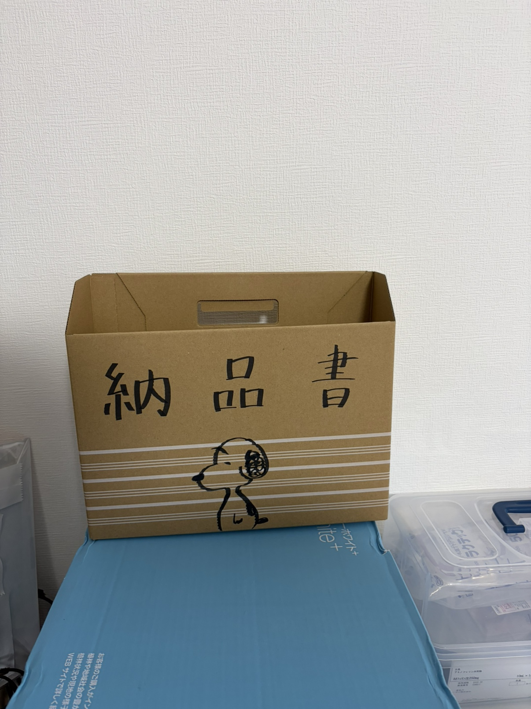

# 在庫管理

## 管理対象

| 分類 | 例 |
|-----|------|
| 医薬品 | 注射薬、輸液、院内処方薬、迅速検査キット |
| 医療消耗品 | 注射針、シリンジ、スピッツ、手袋、ガーゼ、消毒綿 |
| 一般備品 | マスク、ペーパータオル、トイレットペーパー、ハンドソープ |
| 事務用品 | 印刷用紙（A4）、領収証・処方箋用紙（A5） |

## 在庫チェックのタイミング

- **毎日（終業時）**: 翌日の診療に支障がないか確認します。不足があれば院長に報告します。

## 冷蔵庫の温度記録

冷蔵庫の中に温度計があります。**毎日、院内設備管理アプリから庫内の温度を記録してください**。

## 納品時の確認

1. 納品書と現物を照合します
2. 所定の場所に収納します（使用期限の近いものを手前に）
3. 納品書は、薬を置いているテーブルの「納品書」ボックスにまとめて入れます（仕分け不要）

